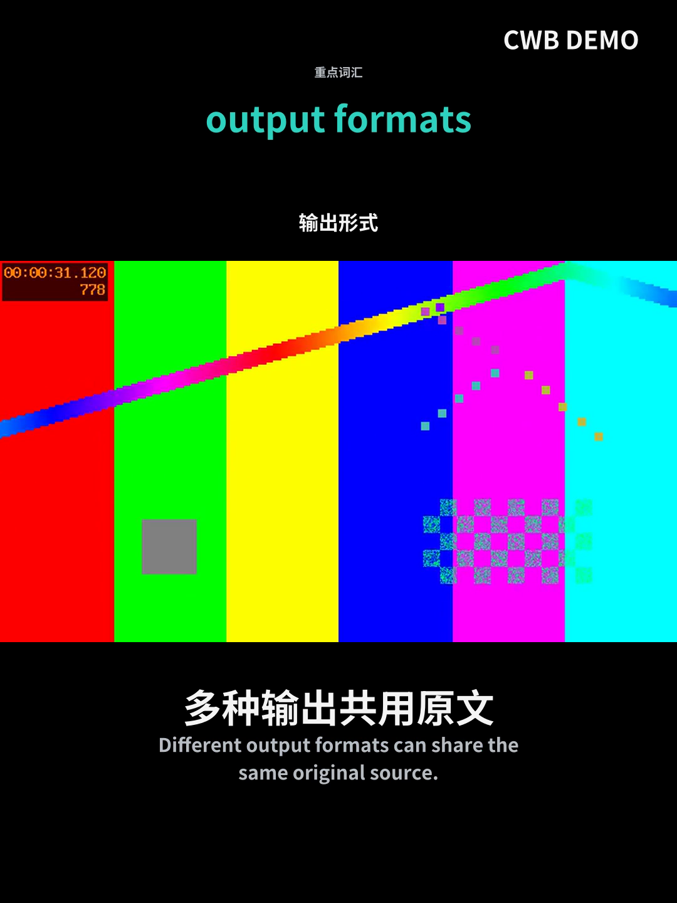
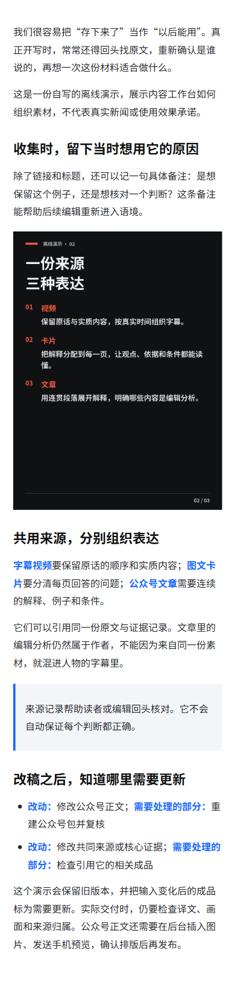
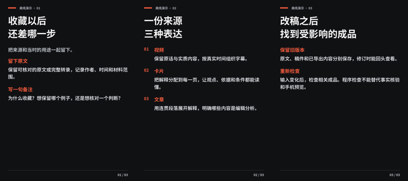

# Content Workbench · 内容工作台

把素材收进来，再按需要做成字幕视频、图文卡片与公众号文章。

这是一个安装到 AI 助手中的 **Skill + 本地工具包**。助手负责理解素材、研究、翻译和写作；工具负责收集、版本记录、确定性排版、媒体合成、检查和导出。v0.1 先支持 Codex；不包含在线账户系统或自动发布。

[下载 v0.1.0 安装包](https://github.com/s26233792-lab/-/releases/tag/v0.1.0) · [使用示例](#在助手中使用) · [验证范围](docs/validation.md)

```text
链接 / 本地视频 / 文章
          ↓
    收集箱：备注、标签、去重
          ↓
   原文 / 全文转录 / 来源核验
          ↓
字幕视频    图文卡片    公众号文章
          ↓
   检查 → 导出 → 回写状态
```

## 能做什么

- 收集单条或批量链接、本地视频与 UTF-8 文稿；仅收集时不下载 URL、不调用模型。
- 根据来源 ID 或本地文件内容去重，保存备注、标签和暂缓状态。
- 获取公开网页正文；支持的在线视频通过可选 yt-dlp 获取。保留原件与提取范围，全文完整性由助手核实。
- 本地 Whisper 转录及检查点续做，也接受其他服务产生的完整转录与真实单词时间。
- 合成 1080×1440 字幕视频：完整原画面、原声、中上英下字幕、青绿逐词跟读、可选顶部重点词。
- 制作 3–6 张 3:4 编辑式卡片、封面、整套缩略预览和三平台文案文件。
- 生成公众号 Markdown、摘要、行内样式 HTML、配图包、900×383 封面与本地预览。
- 内容变化使相关成品和审校记录失效；未变化的目标复用已有成品。导出保留旧版本，逐文件校验副本。

## 安装

需要 Python 3.10+。可以下载发布包并解压，或将仓库克隆到便于识别的目录：

```sh
git clone https://github.com/s26233792-lab/-.git content-workbench
cd content-workbench
```

在项目目录运行：

```sh
python -m pip install ".[render]"
python tools/install_skill.py
```

安装工具把自包含技能复制到 Codex 的用户技能目录（遵守 `CODEX_HOME`）；同名技能已存在时停止，不覆盖。按照宿主的技能发现方式重新载入技能或开启新会话。

视频制作另需 **FFmpeg 和 ffprobe**，并且 FFmpeg 构建包含 libass 与 libx264。在线视频下载和本地转录按需要安装：

```sh
python -m pip install ".[download]"
python -m pip install ".[asr]"
```

Whisper/Torch 的可用 Python 版本与硬件支持由上游决定；不支持时可以使用宿主已有转录能力，再导入标准材料。不要为转换一篇文章安装视频转录模型。

初始化素材工作区并安装固定版本的开源字体：

```sh
cwb --workspace ./workspace init
cwb --workspace ./workspace fonts install
cwb --workspace ./workspace doctor
```

字体下载约 18 MB，来自固定 Google Fonts 提交并验证 SHA-256；随附 SIL OFL 1.1。不会根据系统中“看起来像”的字体判断许可。`doctor` 仅检查能力，不读取密钥或自动安装依赖。

不安装 Python 包时，技能内也可直接执行：

```sh
python skills/content-workbench/scripts/cwb.py --workspace ./workspace init
```

## 在助手中使用

```text
用内容工作台收集下面这五条链接，打上“待选题”标签，先不要下载或制作。

用内容工作台把刚收集的视频做成完整中英字幕版，配封面和小红书、抖音、X 文案。

把第二条素材做成五张图文卡片，再给一份公众号文章发布包。

接着上次的公众号稿，只改标题和封面，复用已经核验的来源。
```

助手会按请求选择输出；缺少某类稿件不是额外制作它的授权。单独使用旧“短视频剪辑”“卡片知识”技能时，仍遵循各自入口；本技能用“内容工作台”或明确收集/跨格式加工请求触发。

## 直接使用工具

```sh
cwb --workspace ./workspace collect "https://example.com/post" --tag 待选题 --note "关注它的实际限制"
cwb --workspace ./workspace batch links.txt
cwb --workspace ./workspace list
cwb --workspace ./workspace fetch ITEM_ID
cwb --workspace ./workspace next ITEM_ID
```

取得素材后，由助手准备文章、字幕、卡片稿和证据记录，然后导入并制作：

```sh
cwb --workspace ./workspace put ITEM_ID evidence evidence.json
cwb --workspace ./workspace put ITEM_ID article article.md
cwb --workspace ./workspace build ITEM_ID wechat
cwb --workspace ./workspace review ITEM_ID wechat review.json
cwb --workspace ./workspace export ITEM_ID wechat --to ./exports
```

`ITEM_ID` 是 `collect`/`list` 返回的 12 位 ID。完整命令与材料格式见 [材料约定](docs/materials.md) 和 [操作与恢复](docs/usage.md)。`review` 记录实际审校，不是新的用户批准关卡；助手完成相应检查后可以如实登记。语义审校不能由“程序运行成功”替代。

## 配置与隐私

默认工作区是用户目录中的 `.content-workbench`；也可设置 `CWB_WORKSPACE` 或逐次指定 `--workspace`。建议放在私有素材目录，与 Git 仓库分开。

- `neutral`：无个人署名，UTC，通用源资料审校。
- `dongning`：可选冻柠样式，Asia/Taipei、`@冻柠`、`BY冻柠AI`，并启用专门的 YouTube 全文预检。规则见 [个人配置](docs/profiles.md)。

```sh
cwb --workspace ./my-content init --profile dongning
cwb --workspace ./my-content config brand "@自己的账号"
cwb --workspace ./my-content config wechat_style editorial
```

本项目不收集遥测，不内置 API 密钥，不上传素材到固定模型服务。宿主助手、可选转录/出图服务的数据处理和费用取决于用户实际配置。收集不等于获准向新的云服务发送全部素材。

## v0.1 的边界

- 公众号输出到可发布文件包，不同步草稿箱、不自动发布。`wechat.html` 保留配图标记；图片须上传至公众号，再做手机预览。`preview.html` 用于本地查看。
- 普通网页抓取不保证支持登录、动态网页、反爬或所有编码。可由宿主浏览器读取并导入经核实的正文。
- 在线视频支持情况取决于平台和 yt-dlp；本次发布的自动测试使用自制离线媒体，不代表每个平台已实测通过。
- 图像工具是可选宿主能力；未配置时使用确定性的文字/抽象图形模板，并明确记录，不将模板称为 AI 插画或真实现场。
- 默认完整处理视频，不自动寻找或删减“精华”。极端时间戳源片、过长单行字幕会明确报错，需先校正。
- 不交付网页播放器代替 MP4，不以关键词扫描冒充完整审阅，不把全片解码成功当作翻译正确的证明。
- 现阶段没有 RSS、浏览器插件、多人编辑或跨设备同步。

## 验证与贡献

```sh
python -m unittest discover -s tests -v
python tools/smoke_demo.py --output ./local-demo
python tools/build_release.py
```

离线样例采用项目自写文稿和自制测试媒体，显式标为演示，不冒充新闻、人物原话或真实转录。查看 [验证范围](docs/validation.md)、[贡献说明](CONTRIBUTING.md) 和 [第三方清单](THIRD_PARTY_NOTICES.md)。

项目自写代码和说明采用 [MIT](LICENSE)。外部字体、依赖、素材和用户输出保留各自的许可条件；开源工具不自动赋予任意视频的再发布权。

## 离线输出示例

下面是自写资料和自制测试片的输出。视频中的彩条属于测试源画面，不是真实人物素材；公众号图是本地手机宽度预览。

 


