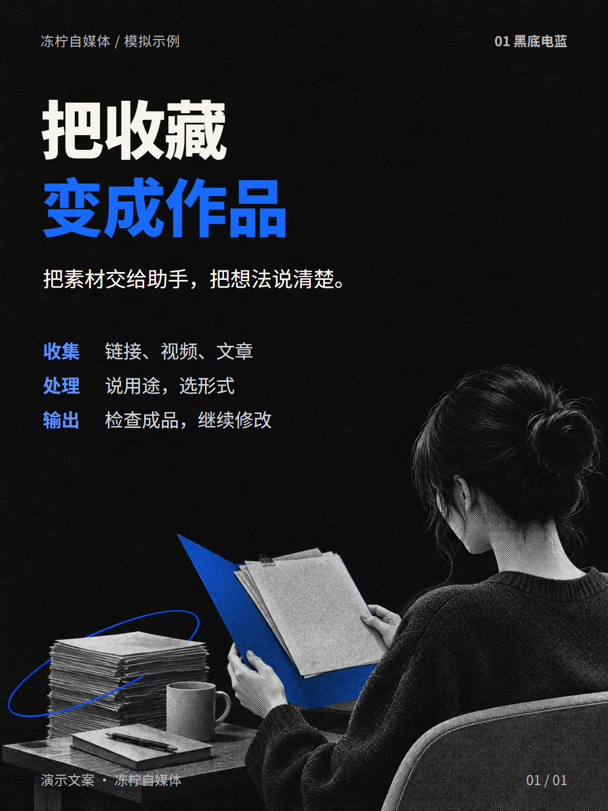
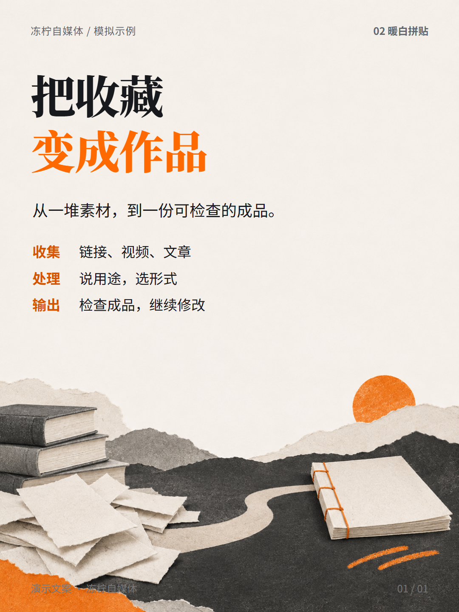
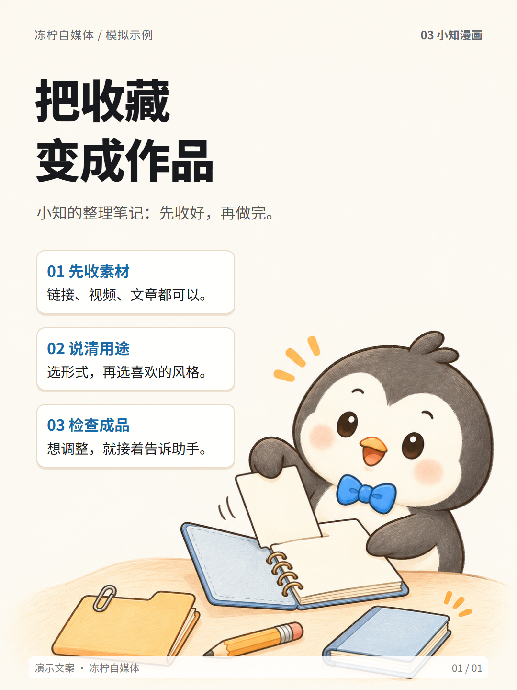
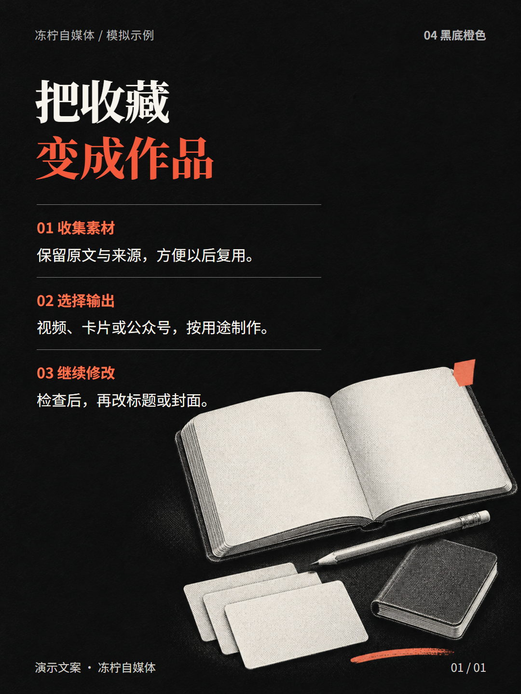
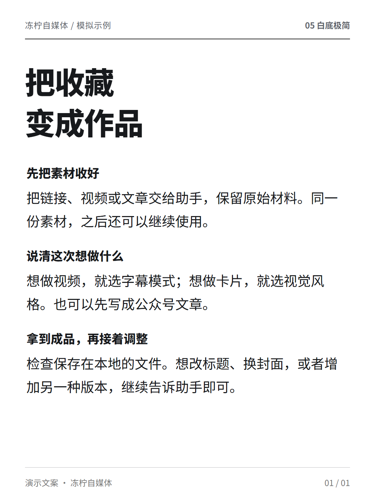
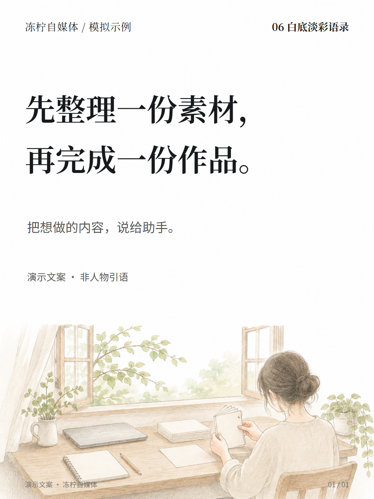
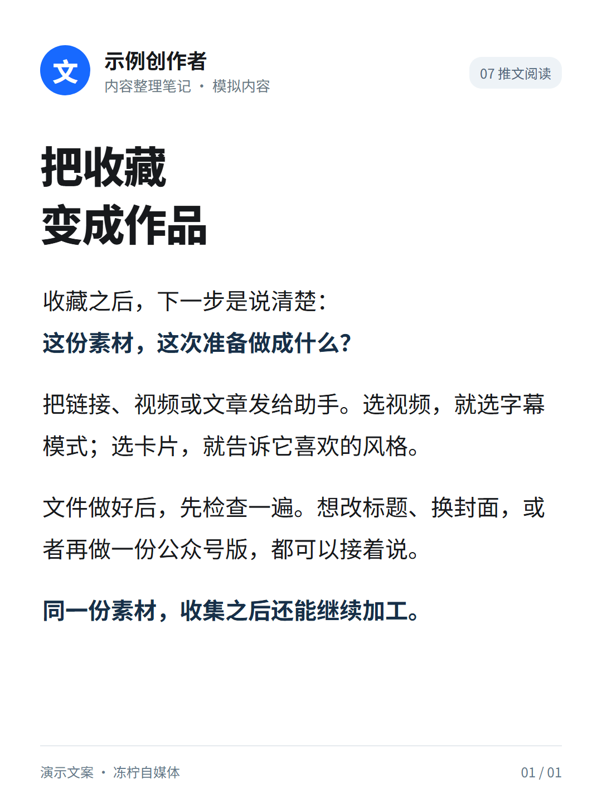

# 选一种卡片风格

把以前使用过的七种视觉方向，统一重新做成“把收藏变成作品”的模拟样张。喜欢哪种，**直接告诉助手编号或名称**；不用写设计提示词。人物、场景与文案都是为这次说明制作的示例，不沿用历史文章、人物原话或账号信息。


```text
用冻柠自媒体 Skill，把这份资料做成图文卡片，选 02 暖白拼贴。
```

也可以说“换成白底极简，正文不动”“这组继续用上次的小知漫画”。新任务没指定时，助手先展示选项；已经选过的同一系列直接沿用。只有你明确说“帮我选”，才由助手代选。

| 编号 | 风格 | 画面特点 | 适合的内容 |
|---|---|---|---|
| 01 | [黑底电蓝](#01-黑底电蓝) | 黑底、灰阶人物、白色大标题、电蓝重点 | 人物访谈、观点封面、科技内容 |
| 02 | [暖白拼贴](#02-暖白拼贴) | 暖白纸张、黑橙配色、撕纸和杂志拼贴 | 商业认知、人生决策、案例解读 |
| 03 | [小知漫画](#03-小知漫画) | 圆润企鹅、手绘线条、柔和配色 | 概念解释、机制拆解、情景故事 |
| 04 | [黑底橙色](#04-黑底橙色) | 深色纸感、米白正文、橙色重点、细线分区 | 知识笔记、观点与解读、多段信息 |
| 05 | [白底极简](#05-白底极简) | 白底黑字、大标题、细分隔线、充足留白 | 长文精读、访谈整理、连续阅读 |
| 06 | [白底淡彩语录](#06-白底淡彩语录) | 大字、宋体气质、下半部铅笔淡彩插画 | 单条语录、短观点、每日分享 |
| 07 | [推文阅读](#07-推文阅读) | 浅色阅读界面、作者信息、正文为主 | 自己的短文、线程整理、短观点连载 |

风格只改变画面，不改变来源、事实和已经确认的正文。知识轮播与单张语录按实际信息量制作，不为了套样式凑页数。

## 01 黑底电蓝

近黑底、柔白大字、灰阶人物；电蓝只用在少量关键词、细线或轮廓光。人物醒目，留白充足。可以直接说“黑色主题”或“黑底灰阶人物配电蓝”。



模拟图使用虚构创作者与新写的演示文案，展示灰阶人物和电蓝重点的搭配。实际制作时换成本次有权使用的素材。

## 02 暖白拼贴

也叫“情绪版”。暖白 `#F8F6F2`、炭黑 `#1A1A1A`、深灰 `#4A4A4A`、橙色 `#FF6A00`；搭配黑白人物、山峰、建筑或物件，少量撕纸边和橙色笔触。封面与内页保持同一套杂志气质。



这次重做为一张完整模拟卡片，展示从零散纸张到整理成册的视觉，不再使用旧情绪板充当样张。

## 03 小知漫画

固定主角是“小知”企鹅 v2：大头圆脸、短胖身体、炭灰轮廓、奶白脸与肚皮、橙色嘴脚、蓝色蝴蝶结、淡粉脸颊。让同一个角色通过动作、场景和旁白讲解，不在每页换一个主角。



沿用小知的角色特征，重新生成整理笔记的场景，并配上三步讲解。实际内容中的编辑讲解和来源人物原话仍要分清。

## 04 黑底橙色

深黑底、米白大字，橙色标出小标题和关键词，细线划开“原文摘句、编辑解读、具体用法”。适合信息较多、需要清楚分层的知识卡。



新写的演示文案分成收集、处理、输出三个层次。本地基础模板提供相近的深色分区排版；图中的宋体、纸感和网点插画需要相应的制作能力。

## 05 白底极简

白底黑字，顶部自然标明作者或主题，标题加粗，用细线和留白组织正文。可按素材需要穿插真实配图，或保持纯文字；不把正文缩成密密麻麻的小字。



用同一主题的三段完整说明展示连续阅读效果。白底精读与按需加入真实配图的版本归在这一类，不另列重复选项。

## 06 白底淡彩语录

竖版 3:4、纯白底，上半部深黑大字与独立作者署名，下半部细腻铅笔淡彩插画。暖灰、鼠尾草绿等颜色只轻轻点染；场景跟随内容变化，不固定重复演讲人物。



文字是本项目新写的演示短句，图内明确标注“非人物引语”。实际制作名人语录时，仍需核对原文、作者和出处。

## 07 推文阅读

浅色背景、清楚的作者栏、正文大字、少量蓝灰色辅助信息，适合一条观点一页或连续短文。也可以说“X 阅读风格”。



使用“示例创作者”和通用文字头像，无真实账号、认证标记、互动数据或平台标志；这是阅读卡排版，不是平台原帖截图。

## 选好以后会怎样

助手记录本次风格，先整理正文，再按参考制作；封面、内页保持统一。你只改风格时，复用已有文案、来源和人物素材。正式作品使用你自己的署名，或不署名。

这些是**供 AI 助手制作时使用的风格参考**。目前命令行 `build … cards` 内置的是深色基础排版，并没有七套自动换肤模板。其余风格需要助手具备相应的出图、排版和图片导出能力；没有时会说明缺少的能力，继续交付文稿，或由你决定是否改用基础模板，不会静默换一种风格。

想看制作约定，见技能内的[风格库](../skills/content-workbench/references/card-styles.md)。新样张的制作方法见[样张说明](../skills/content-workbench/references/styles/NOTICE.md)与[生成提示词和字体记录](images/simulated-samples.md)。

[返回使用说明](../README.md)
