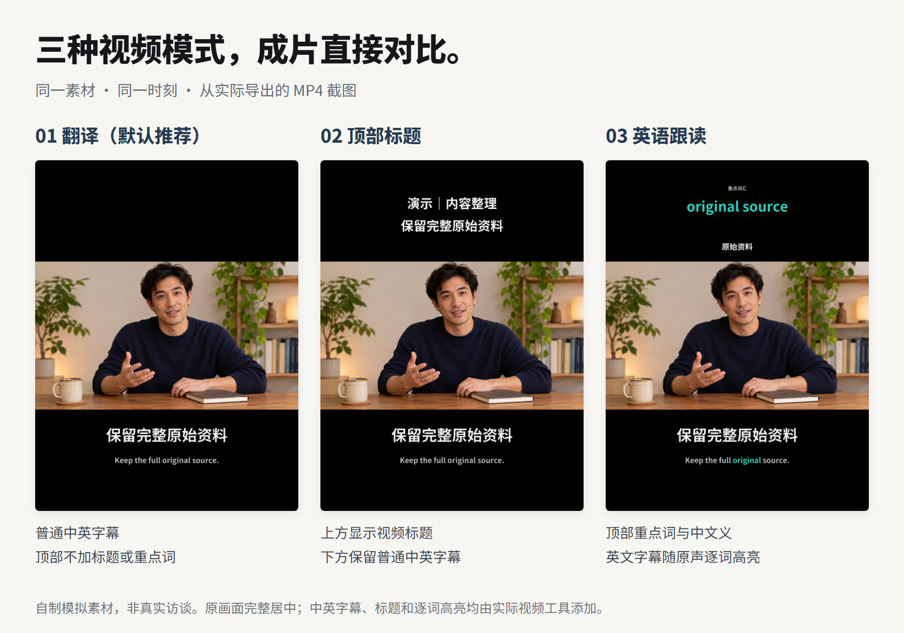
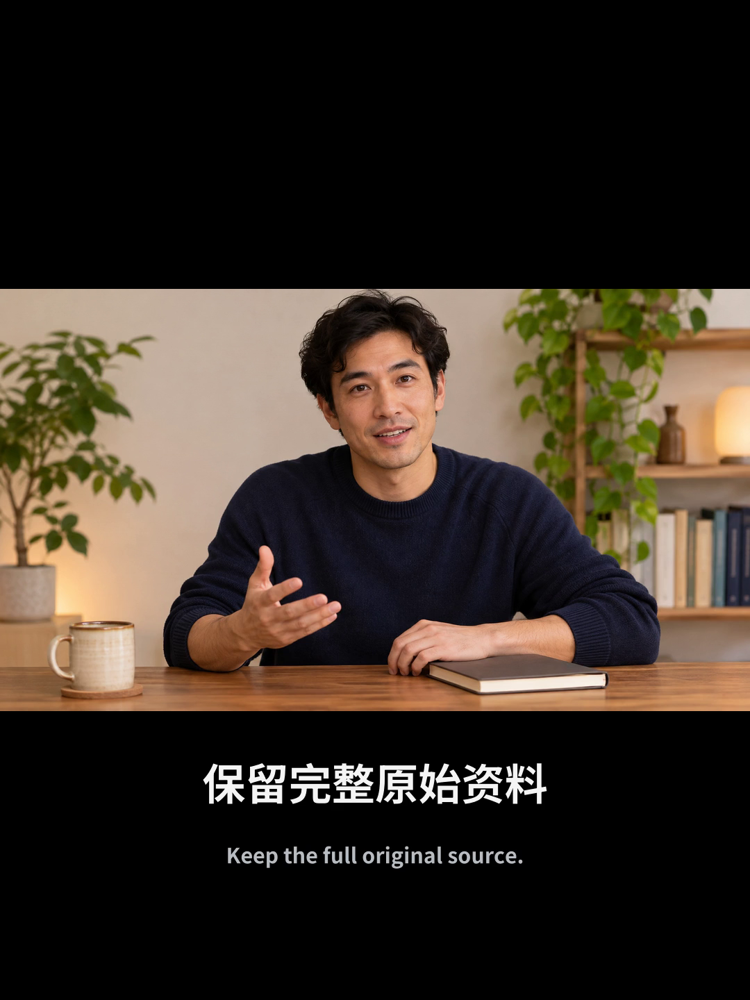
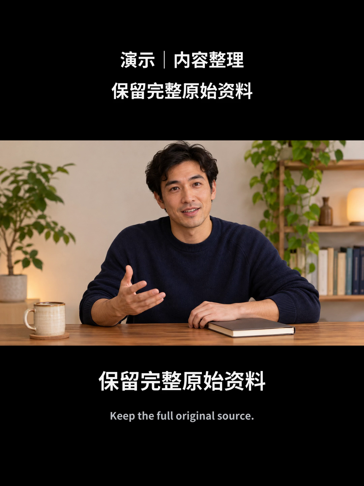
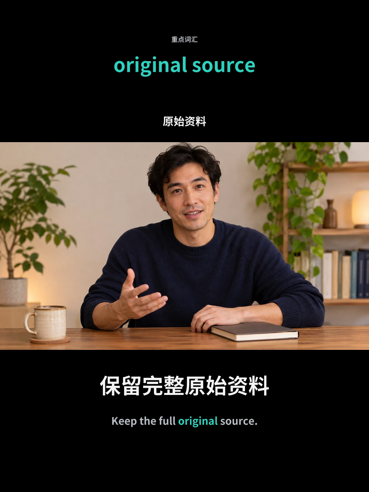

# 剪辑后的视频效果

三种模式用同一份素材、同一时刻对照。人物画面与语音为自制模拟素材，下面的图片均从**工具实际导出的 MP4** 截取，用于展示成片排版。

| 你选择的模式 | 顶部内容 | 下方字幕 |
|---|---|---|
| 翻译（默认推荐） | 留白 | 普通中英字幕 |
| 顶部标题 | 本条视频标题 | 普通中英字幕 |
| 英语跟读 | 英文重点词与中文义 | 正在读的英文词变青绿 |

三种模式都采用 3:4 画布，完整原画面居中，下方中文在上、英文在下，无侧栏和时间轴。默认推荐翻译；选好后才开始制作。

## 01 翻译

适合只想看懂内容的用户。保留完整画面，配普通中英字幕，顶部不加标题或重点词。

直接说：“用内容工作台，翻译这个视频，配中英字幕。”

## 02 顶部标题

在上方黑色留白里显示视频标题，便于读者直接看出主题。下方仍是普通中英字幕。

直接说：“把这个视频做成中英字幕版，上面加标题。”

## 03 英语跟读

顶部显示重点英文词或短语及中文义。英文字幕随着原声逐词高亮；截图里正在读的是 `original`。静态截图只展示其中一刻，实际视频中的高亮会随词时间切换。

直接说：“用英语跟读模式，英文逐词高亮，上面显示重点词和中文意思。”

## 示例说明

画面是新生成的虚构人物静态图，声音来自项目自写的合成语音，不是真实访谈，也不是人物口型同步演示。先组成短测试源，再经过同一个视频制作工具分别导出三种模式，最后从成片截帧；字幕和顶部内容由实际渲染器添加。

示例片长用于展示模式，没有给用户视频设置时长上限。制作与检查记录、源图提示词见[示例记录](images/video-modes-record.md)。

[返回使用说明](../README.md)
